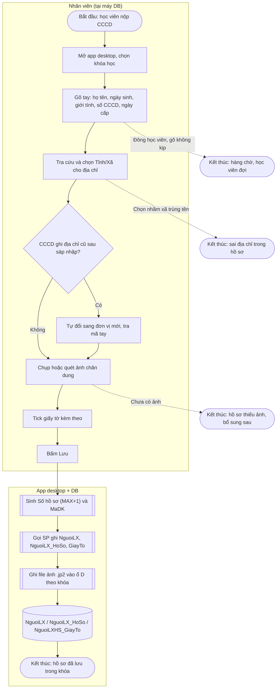

# Luồng: Thu nhận hồ sơ học viên — hiện tại (as-is)

**Phiên bản:** as-is · **Ngày:** 30/09/2026 · **Người lập:** BA (Claude)
**Nguồn:** quan sát `UI.png` (màn "Thu nhận Hồ sơ cấp mới") + DB thật `GPLX_CSDT` + chủ dự án

## Tóm tắt

Nhân viên ngồi tại máy tính chứa DB, mở app desktop cũ. Với mỗi học viên: chọn khóa học, gõ tay toàn bộ thông tin từ CCCD, tự tra và chọn đơn vị hành chính, chụp/quét ảnh chân dung rời, tick giấy tờ, rồi bấm Lưu. App tự sinh Số hồ sơ + MaDK, ghi DB và file ảnh. Mỗi học viên là một lần nhập thủ công đầy đủ; chỉ làm được tại máy có DB.

## Sơ đồ

*(Sơ đồ đã kiểm cú pháp bằng đọc: mọi node có khai báo, nhãn chứa dấu đặc biệt đã bọc `"…"`, subgraph có `end`, mũi tên `-->`/`-.->`.)*

## Chi tiết từng bước

| Mã | Bước | Vai trò | Kích hoạt | Đầu vào | Đầu ra | Hệ thống | Thời gian | Hỏng kiểu gì |
|---|---|---|---|---|---|---|---|---|
| A | HV nộp CCCD | Học viên | Đến quầy | CCCD | — | — | — | — |
| B | Chọn khóa | Nhân viên | Bắt đầu nhập | Danh sách khóa | Khóa chọn | App | ngắn | Chọn nhầm khóa |
| C | Gõ thông tin cá nhân | Nhân viên | Sau chọn khóa | CCCD (đọc bằng mắt) | Các trường | App | lâu nhất | Gõ sai, chậm |
| D | Chọn địa chỉ Tỉnh/Xã | Nhân viên | — | Danh mục DVHC | Mã DVHC | App+DM_DVHC | trung bình | Chọn sai xã |
| E/F | Đổi địa chỉ cũ→mới | Nhân viên | CCCD địa chỉ cũ | Kiến thức sáp nhập | Xã mới | thủ công | trung bình | Đổi sai |
| G | Chụp/quét ảnh | Nhân viên | — | Máy ảnh/scanner | Ảnh | App | trung bình | Thiếu/ mờ |
| H | Tick giấy tờ | Nhân viên | — | — | 3 tick | App | ngắn | — |
| I-M | Lưu | App+DB | Bấm Lưu | Toàn bộ | Hồ sơ | SP + FS | ngắn | Lỗi ghi |

## Các trạng thái kết thúc

| Trạng thái | Nghĩa | Còn sửa được | Bước tiếp |
|---|---|---|---|
| Hồ sơ đã lưu trong khóa | HV có mặt trong DB, hiển thị trên lưới | Có (mở sửa app cũ) | Sát hạch sau |
| Sai địa chỉ trong hồ sơ | Lưu nhưng DVHC sai | Có (phải phát hiện) | Sửa tay |
| Hàng chờ, học viên đợi | Nghẽn đầu khóa | — | — |
| Hồ sơ thiếu ảnh | Lưu chưa có ảnh | Có (bổ sung sau) | Thêm ảnh |

## Nhánh ngoại lệ

| Mã | Tình huống | Ở bước | Hệ thống làm gì | Ai được báo |
|---|---|---|---|---|
| EX-1 | Chọn nhầm xã trùng tên | D | Không phát hiện, lưu sai | Không ai (đến khi rà) |
| EX-2 | Đông HV, gõ không kịp | C | Không có gì, xếp hàng | Nhân viên/HV |
| EX-3 | Chưa có ảnh | G | Cho lưu thiếu ảnh | Nhân viên |

## Quy tắc nghiệp vụ áp dụng

| Mã | Tóm tắt | Bước |
|---|---|---|
| BR-002 | SoHoSo 3 số MAX+1/khóa | J |
| BR-003 | MaDK timestamp | J |
| BR-009 | Giấy tờ theo loại/hạng | H |
| BR-010 | Ảnh .jp2 theo khóa | L |
| BR-011 | Cho vượt sĩ số | B |

## Điểm đau

| # | Điểm đau | Ở bước | Ai chịu | Tần suất | Chi phí |
|---|---|---|---|---|---|
| 1 | Gõ tay lại toàn bộ từ CCCD | C | Nhân viên | Mỗi HV | `[GIẢ ĐỊNH]` giờ công |
| 2 | Tra + đổi địa chỉ cũ→mới bằng tay | D/F | Nhân viên | Nhiều HV có CCCD cũ | Lỗi + thời gian |
| 3 | Bị trói tại máy DB | toàn luồng | Nhân viên | Luôn | Không thu nhận từ xa |
| 4 | Nghẽn đầu khóa | C | Nhân viên + HV | Đầu mỗi khóa | HV chờ |

## Chưa xác định được

| Câu hỏi | Ai trả lời | Chặn |
|---|---|---|
| Số HV/khóa + thời gian gõ/HV | Nhân viên thu nhận | Định lượng điểm đau |
