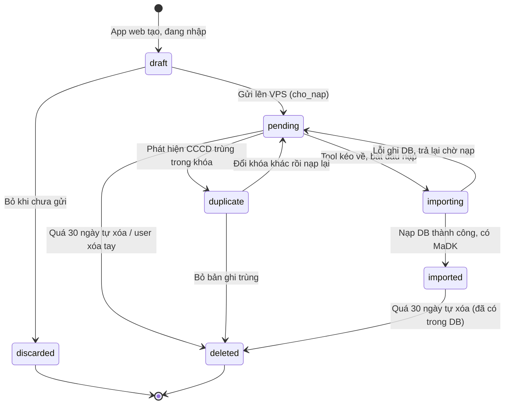

# Vòng đời trạng thái — Hồ sơ thu thập (bản ghi trên VPS)

**Ngày:** 30/09/2026 · **Người lập:** BA (Claude)

> Đối tượng có vòng đời trong hệ thống mới = **bản ghi học viên thu thập trên VPS** (từ lúc app web tạo tới lúc nạp DB / xóa). Đây là nguồn chuẩn cho enum `trang_thai` của backend VPS, quyền theo trạng thái (Pha 4) và edge case trục T1 (Pha 5).
> Hồ sơ SAU khi vào DB `GPLX_CSDT` theo vòng đời riêng của hệ thống cũ (`TT_XuLy`) — ngoài phạm vi module này.

## 1. Sơ đồ chuyển trạng thái

**Quy ước:** enum `trang_thai` dùng `snake_case` tiếng Anh (contract kỹ thuật): `draft`, `pending`, `importing`, `imported`, `duplicate`, `deleted`, `discarded`.

## 2. Bảng trạng thái

| Trạng thái | Nghĩa nghiệp vụ | Bất biến? | Ở đâu | Ảnh | Ai thấy |
|---|---|---|---|---|---|
| `draft` | Đang nhập trên app web, chưa gửi | Không | Thiết bị/app web | Ảnh thô | Người nhập |
| `pending` | Đã gửi VPS, chờ nạp | Không (cho sửa) | VPS | Ảnh thô | NV thu nhận, NV nạp DB |
| `importing` | Tool đang xử lý nạp | Khóa tạm | VPS+tool | Đang xử lý .jp2 | NV nạp DB |
| `imported` | Đã vào DB, có MaDK | **Bất biến** (trên VPS) | VPS (chờ xóa) + DB | .jp2 trong DB | NV nạp DB |
| `duplicate` | CCCD trùng trong khóa đã chọn | Không | VPS | Ảnh thô | NV nạp DB |
| `deleted` | Đã xóa khỏi VPS (PII) | **Bất biến** | — | Đã xóa | — |
| `discarded` | Bỏ khi chưa gửi | **Bất biến** | — | — | — |

## 3. Bảng phép chuyển

| Từ | Đến | Ai được làm | Điều kiện | Việc kèm theo |
|---|---|---|---|---|
| `draft` | `pending` | NV thu nhận | Đủ trường tối thiểu | Upload ảnh thô + bản ghi lên VPS, cấp UUID (BR-015) |
| `pending` | `importing` | NV nạp DB | Đã chọn khóa chưa BC1 (BR-012) | Khóa bản ghi để tránh 2 tool cùng nạp |
| `importing` | `imported` | Tool | 3 SP chạy xong (BR-001) | Lưu MaDK vào bản ghi, set `da_nap` (BR-015), ghi file .jp2 |
| `importing` | `pending` | Tool | Lỗi ghi DB | Rollback SP, mở khóa bản ghi |
| `pending` | `duplicate` | Tool | SoCMT đã có trong khóa (BR-005) | Cảnh báo, không nạp |
| `duplicate` | `pending` | NV nạp DB | Chọn khóa khác | — |
| `pending`/`imported` | `deleted` | Hệ thống / NV nạp DB | Quá 30 ngày HOẶC user xóa tay (BR-016) | Xóa bản ghi + ảnh thô khỏi VPS |

## 4. Phép chuyển KHÔNG hợp lệ

| Từ | Đến | Vì sao cấm | Hệ thống làm gì |
|---|---|---|---|
| `imported` | `importing`/`pending` | Đã vào DB, nạp lại sẽ tạo HV thứ 2 (MaDK mới) | Chặn (BR-015) |
| `deleted` | bất kỳ | Đã xóa PII, không khôi phục | Chặn |
| `importing` | `importing` (tool khác) | Hai tool cùng nạp một bản ghi | Khóa bản ghi khi bắt đầu |

## 5. Trạng thái cuối và dọn dẹp

| Trạng thái cuối | Giữ bao lâu | Vào báo cáo | Ghi chú |
|---|---|---|---|
| `imported` | ≤ 30 ngày trên VPS rồi `deleted` | Không (DB là nguồn chính) | Giữ để đối chiếu/nạp lại nếu phát hiện lỗi (Câu 6=B) |
| `deleted` | — | Không | PII đã xóa |
| `discarded` | — | Không | Chưa từng lên VPS |

## 6. Edge case sinh ra từ vòng đời (→ `08-edge-cases.md` trục T1/T2)

| Tình huống | EC- |
|---|---|
| Bản ghi kẹt ở `importing` khi tool tắt giữa chừng | EC (T2/T7) |
| Hai tool cùng kéo và nạp một bản ghi `pending` | EC (T2) |
| Bản ghi `imported` bị nạp lại lần 2 | EC (T3) |
| `pending` quá 30 ngày đúng lúc đang nạp | EC (T1/T5) |
| Xóa PII (`deleted`) nhưng ảnh .jp2 đã ghi vào DB | EC (T3) — ảnh trong DB giữ, chỉ xóa bản thô VPS |
