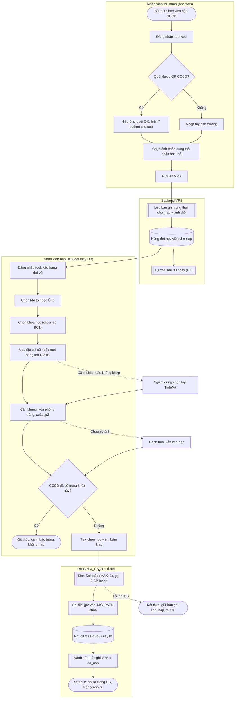

# Luồng: Thu nhận hồ sơ học viên — mục tiêu (to-be)

**Phiên bản:** to-be · **Ngày:** 30/09/2026 · **Người lập:** BA (Claude)
**Nguồn:** thiết kế từ `03-findings.md`, bám SP có sẵn của DB

## Tóm tắt

Tách làm 2 khâu: **thu thập** (app web trên điện thoại/máy tính, quét QR + chụp ảnh thô, gửi lên VPS) và **nạp DB** (tool tại máy DB kéo dữ liệu về, map địa chỉ, căn ảnh + xóa phông + xuất `.jp2`, chọn khóa, nạp qua SP có sẵn). Bản ghi tạo ra hiển thị y app cũ. App web + tool đều cho sửa. Tool cũng quản lý (tra cứu/sửa/đổi khóa/xóa) hồ sơ đã có và tạo khóa học mới.

## Sơ đồ

*(Sơ đồ kiểm cú pháp bằng đọc: node khai báo đủ, nhãn có dấu đặc biệt bọc `"…"`, subgraph có `end`, mũi tên đúng.)*

## Chi tiết từng bước

| Mã | Bước | Vai trò | Kích hoạt | Đầu vào | Đầu ra/trạng thái | Hệ thống | Thời gian | Hỏng kiểu gì |
|---|---|---|---|---|---|---|---|---|
| B | Đăng nhập app web | NV thu nhận | Mở app | Tài khoản | Phiên | App web | ngắn | Sai mật khẩu |
| C/D | Quét QR + preview sửa | NV thu nhận | HV nộp CCCD | QR CCCD | 7 trường | App web (camera) | ngắn | QR mờ/hỏng |
| E | Nhập tay | NV thu nhận | QR lỗi | Đọc CCCD | Các trường | App web | trung bình | Gõ sai |
| F | Chụp ảnh thô | NV thu nhận | — | Camera | Ảnh JPEG | App web | ngắn | Thiếu ảnh |
| G/H | Gửi + lưu VPS | App web/VPS | Bấm gửi | Bản ghi + ảnh | `cho_nap` | Backend | ngắn | Mất mạng |
| K | Kéo hàng đợi | NV nạp DB | Mở tool | Token | DS chờ nạp | Tool+VPS | ngắn | VPS lỗi |
| L/M | Chọn loại + khóa | NV nạp DB | — | DM khóa (chưa BC1) | Khóa chọn | Tool+DB | ngắn | — |
| N | Map địa chỉ | Tool | — | DM_DVHC_MAP + DM_DVHC | Mã DVHC | Tool+DB | ngắn | Xã chia |
| O | Xử lý ảnh | NV nạp DB | — | Ảnh thô | .jp2 480×640 | Tool (rembg+Pillow) | trung bình | Xóa phông xấu |
| P | Kiểm trùng | Tool | Trước nạp | SoCMT + khóa | OK/cảnh báo | Tool+DB | ngắn | — |
| R-W | Nạp DB | Tool+DB | Bấm Nạp | Toàn bộ | Hồ sơ + `da_nap` | 3 SP + FS | ngắn | Lỗi SP |

## Các trạng thái kết thúc

| Trạng thái | Nghĩa | Còn sửa | Bước tiếp |
|---|---|---|---|
| Hồ sơ trong DB (hiện y app cũ) | Nạp thành công, có MaDK | Có (tool + app cũ) | Sát hạch |
| Cảnh báo trùng, không nạp | CCCD đã có trong khóa | — | Chọn khóa khác/bỏ |
| Giữ bản ghi cho_nap, thử lại | Lỗi ghi DB | Có | Nạp lại |

## Nhánh ngoại lệ

| Mã | Tình huống | Ở bước | Hệ thống làm gì | Ai được báo |
|---|---|---|---|---|
| EX-1 | QR không quét được | C | Chuyển sang nhập tay | NV thu nhận |
| EX-2 | Xã bị chia / không khớp map | N | Cho chọn tay Tỉnh/Xã | NV nạp DB |
| EX-3 | Chưa có ảnh khi nạp | O | Cảnh báo mềm, vẫn cho nạp | NV nạp DB |
| EX-4 | CCCD trùng trong khóa | P | Chặn nạp, cảnh báo | NV nạp DB |
| EX-5 | Lỗi ghi DB giữa chừng | S | Rollback (transaction SP), giữ `cho_nap` | NV nạp DB |
| EX-6 | Mất mạng khi gửi VPS | G | App web giữ nháp, gửi lại | NV thu nhận |

## Quy tắc nghiệp vụ áp dụng

| Mã | Tóm tắt | Bước |
|---|---|---|
| BR-001 | Nạp qua SP | R-W |
| BR-002/003 | SoHoSo, MaDK | S |
| BR-005 | Chặn trùng CCCD cùng khóa | P |
| BR-006 | Map DVHC | N |
| BR-007/008/009 | Loại HS, HTCap, giấy tờ | S |
| BR-010/019 | Ảnh .jp2 + config path | O,T |
| BR-011 | Nạp mềm | O,R |
| BR-012 | Khóa chưa BC1 | M |
| BR-015 | Chống trùng UUID | K,V |
| BR-016 | PII 30 ngày | H,J |
| BR-018 | QR preview sửa được | C,D |
| BR-020 | Đăng nhập riêng | B,K |

## Thay đổi so với as-is

| Bước as-is | Số phận | Quy tắc đi đâu |
|---|---|---|
| Gõ tay toàn bộ tại máy DB | Tự động hóa | Điền sẵn từ QR (app web); tool tự suy trường theo khóa |
| Tra + đổi địa chỉ tay | Tự động hóa | `DM_DVHC_MAP` map cũ→mới (BR-006) |
| Chụp/quét ảnh rời tại máy DB | Tách + tự động | Điện thoại chụp thô, tool căn + xóa phông + .jp2 (BR-010) |
| Bị trói tại máy DB | Bỏ | App web thu thập mọi lúc/nơi |
| Chọn khóa mọi khóa | Thu hẹp | Chỉ khóa chưa BC1 (BR-012) |
| Sinh SoHoSo/MaDK | Giữ | BR-002/003 y hệt |
| Tick giấy tờ | Giữ (mặc định nộp đủ) | BR-009 |

## Chưa xác định được

| Câu hỏi | Ai trả lời | Chặn |
|---|---|---|
| Định dạng QR CCCD thật của cơ sở | Test thẻ | Bước C |
| Có cần chế độ offline app web không | NV thu nhận | Bước G (EX-6) |
